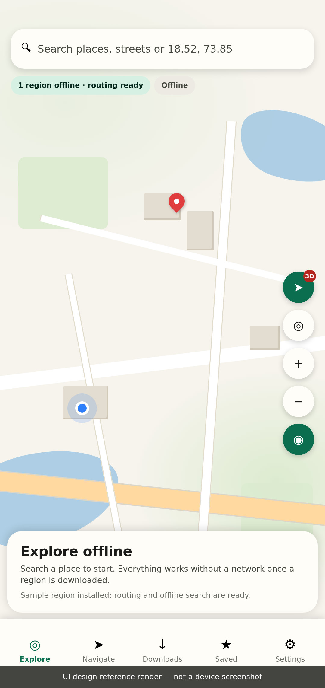
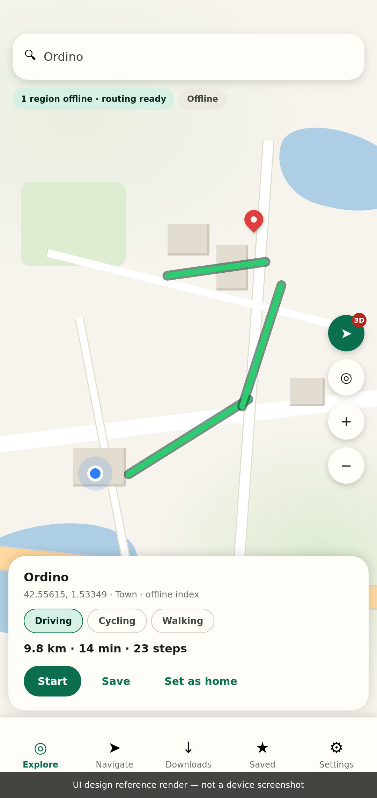
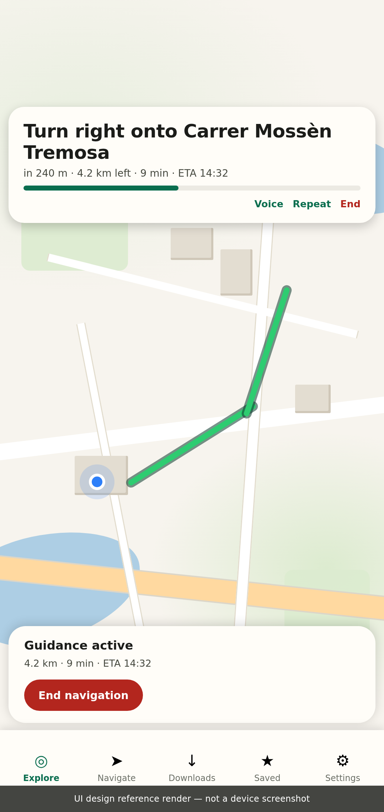
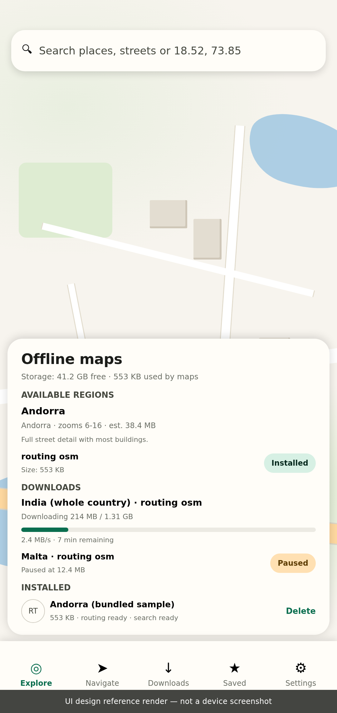

# Offline Maps — offline-first 3D world map & navigation for Android

An Android app that renders OpenStreetMap data in 3D with MapLibre, lets you download map regions
for offline use, searches them without a network, and gives real turn-by-turn navigation from
downloaded road-network data. No Google Maps, no paid API keys, no account.

Project title: **WorldMap 3D Offline** · App name: **Offline Maps** · package `com.offlinemaps.app`

[](https://github.com/technicalnihilist-lgtm/offline-maps/actions/workflows/android.yml)

**[⬇ Download the debug APK](https://github.com/technicalnihilist-lgtm/offline-maps/releases/latest)** —
debug-signed, built by GitHub Actions from this source.

**[Open the browser demo](docs/web-demo.html)** — a single HTML file with the same generated 3D
style, the same 256-place search pack and the same tile arithmetic. Useful for seeing the map
without installing anything; offline caching and routing stay on the device.

---

## Interface: liquid glass

The chrome over the map — search bar, control buttons, status chips, bottom bar and the bottom
sheets — is drawn with a layered glass treatment (`core/ui/Glass.kt`): a translucent tint, a diagonal
sheen, a specular highlight near the top edge, a refractive rim as a gradient border, and a soft
two-layer shadow for lift. The bottom bar carries a single pill that springs between tabs and
stretches slightly while travelling.

It is deliberately **not** a live backdrop blur. Blurring what sits behind a view is not cheap in
Compose, and doing it over a map that repaints every frame is exactly the kind of effect that drains a
battery — which this app is meant to avoid. The layered shading is what sells the material instead.
Both light and dark themes derive their glass from the active colour scheme, so there is no second
palette to keep in sync.

The same look is implemented in the [browser demo](docs/web-demo.html) in CSS, which is where the
direction started.

---

## Screenshots

These are **UI design reference renders**, generated from the same layout, colours and strings as
the Compose UI — not device screenshots. No emulator was available in the build environment
(`/dev/kvm` absent), and no APK could be built there, so a real capture was impossible. Each image
carries that caption in the artwork itself. See [`docs/SCREENSHOTS.md`](docs/SCREENSHOTS.md).

| Explore | Route preview |
|---|---|
|  |  |

| Turn-by-turn guidance | Downloads |
|---|---|
|  |  |

---

## What actually works, and what does not

This section is first on purpose. Read it before anything else.

| Area | Status |
|---|---|
| Kotlin/Compose app, 9-module architecture | **Implemented**, compiles |
| MapLibre vector map with tilt/rotate, 2D↔3D toggle, dark/light themes | **Implemented** (needs a device to render) |
| 3D extruded buildings + terrain DEM + hillshade from open data | **Implemented** as generated style layers |
| Offline map tile downloads (MapLibre offline store) + MBTiles import | **Implemented** |
| Resumable HTTP downloads with checksum verification, pause/cancel/retry | **Implemented and unit-tested** |
| Offline search (SQLite FTS4 over a generated places pack) | **Implemented**, SQL verified against real SQLite |
| Offline routing (GraphHopper 2.4, pre-built graph loaded on device) | **Implemented and integration-tested** against the shipped graph |
| Turn-by-turn tracking, off-route detection, rerouting, TTS | **Implemented**, core logic unit-tested |
| Unit tests | **652 tests, 0 failures** on GitHub Actions (see `docs/TESTING.md`) |
| Debug APK | **Built by CI and published** on the [latest release](https://github.com/technicalnihilist-lgtm/offline-maps/releases/latest) |
| Screenshots | **Design renders only** — no emulator available, so no device captures exist |

### Honest limitations

* **The APK is debug-signed.** Fine for sideloading and testing; sign with your own key before
  distributing (see `docs/BUILDING.md`).
* **Nothing has been run on a physical device or an emulator.** This environment had no
  `/dev/kvm` and no GPU, so map rendering, GPS, permissions, airplane mode and voice playback are
  implemented and their logic is unit-tested, but the end-to-end device behaviour is unverified.
  `docs/TESTING.md` carries the manual checklist to run on a phone.
* **Building heights are partly estimated.** Where OpenStreetMap has `height`/`levels` we use them;
  otherwise the style falls back to 3 m per level and then 4 m. These are estimates and the UI does
  not pretend otherwise. There is no photorealistic 3D city model anywhere in this app.
* **Routing speed models are simplified.** GraphHopper 2.4 requires an explicit custom model per
  profile; ours caps speed by road class and honours `maxspeed` when tagged. It is not a
  lane-level traffic model.
* **Offline map tiles and offline routing are separate downloads.** Tiles make the *map* work with no
  network; routing needs a routing graph, which a phone cannot build (see below). The bundled Andorra
  sample includes one, so the full offline route flow is demonstrable there.
* **A phone cannot build a routing graph from a raw OSM extract.** GraphHopper's OSM reader depends
  on `javax.xml.stream`, which Android does not implement, so the reader class cannot even be loaded
  on a device. (This was the v1.0.0 crash after installing a region.) The app therefore loads a
  pre-built graph: `app/src/main/assets/routing_andorra.zip` is built from a real Andorra extract by
  `tools/build_routing_graph.sh`. To route in another region you build a graph there and ship or host
  it as a package; the Downloads screen refuses raw extracts up-front rather than pulling gigabytes
  that could not be installed.
* **No satellite imagery.** No appropriately licensed global imagery source was integrated, so the
  app does not offer one rather than shipping a broken layer.

---

## Architecture

Nine Gradle modules; the dependency direction is strictly UI → core.

```
app/                     Compose UI, view models, navigation, foreground service, TTS, DI
core/common/             GeoPoint/GeoBounds, spherical geometry, tile maths, formatters, domain enums
core/data/               Room (saved places, recent searches, downloads, installed regions), settings
core/map/                MapLibre style generator (3D buildings, terrain), offline region controller
core/offline/            Resumable download engine, checksums, storage guard, region catalogue
core/search/             SQLite FTS4 index, places-pack reader, search repository
core/routing/            GraphHopper wrapper, route model, navigation tracker, guidance announcer
core/location/           Platform LocationManager source, permission copy
core/ui/                 Design system: theme, floating panels, status chips, progress rows
```

Key decisions and why:

* **MapLibre Native 11.5.2** — open source, no API key, real vector rendering with `fill-extrusion`
  and `raster-dem` terrain. Style is *generated in Kotlin* so themes/quality/3D toggles do not need
  duplicate asset files.
* **GraphHopper 2.4 core, on device** — pure JVM, so it runs on Android with no NDK build and no
  native toolchain in CI. Measured here: importing the Andorra extract took ~13.8 s and reloading
  the persisted graph ~0.3 s.
* **Room** for user data, **plain SQLiteOpenHelper + FTS4** for the search index (bulk import is
  faster without Room's per-entity overhead).
* **Platform `LocationManager`, not Play Services** — offline navigation must not depend on a
  network-backed provider, and the app should work on de-Googled devices.
* **Hand-rolled DI** (`ServiceLocator`) instead of Hilt — fewer moving parts, faster builds.

### Data flow for a download

`DownloadsViewModel` → `DownloadManager` (HTTP + resume + checksum, `.part` file) → on success
`PackageInstaller` routes by type: OSM PBF → GraphHopper import, places pack → FTS index, MBTiles →
MapLibre `mergeOfflineRegions`. State is persisted in Room so a killed process resumes.

---

## Data sources and licensing

| Data | Source | Licence |
|---|---|---|
| Vector tiles (online browsing) | [OpenFreeMap](https://openfreemap.org) (OpenMapTiles schema) | ODbL 1.0 data, free service |
| Terrain DEM | Mapzen/AWS Open Data "Terrarium" elevation tiles | open data (AWS Open Data registry) |
| Routing extracts | [Geofabrik](https://download.geofabrik.de) OSM extracts | ODbL 1.0 |
| Bundled routing graph (`assets/routing_andorra.zip`) | built from an OpenStreetMap Andorra extract by `tools/build_routing_graph.sh` | ODbL 1.0, © OpenStreetMap contributors |
| Places pack (`assets/places_andorra.jsonl.gz`) | generated from that extract by `tools/build_places_pack.py` | ODbL 1.0 |
| Region catalogue (`assets/regions.json`) | hand-written bounding boxes and zoom ranges, no third-party data | project data |

Attribution is shown in the app's Settings screen and must be preserved if you redistribute map
data. No proprietary dataset (Google, Apple, HERE) is used or accessed.

---

## Building

Requirements: JDK 17, Android SDK with platform 35 and build-tools 34.0.0, Gradle 8.9 (wrapper
included).

```bash
git clone <this repo> offline-maps && cd offline-maps
echo "sdk.dir=$HOME/Android/Sdk" > local.properties
./gradlew :app:assembleDebug            # debug APK -> app/build/outputs/apk/debug/
./gradlew test                          # JVM unit tests
./gradlew :app:assembleRelease          # release APK (signed with debug key unless configured)
```

Release signing (never commit these):

```bash
export OFFLINEMAPS_KEYSTORE=/path/to/release.jks
export OFFLINEMAPS_KEYSTORE_PASSWORD=...
export OFFLINEMAPS_KEY_ALIAS=...
export OFFLINEMAPS_KEY_PASSWORD=...
./gradlew :app:assembleRelease
```

Details, proxy/CI hints and troubleshooting: [`docs/BUILDING.md`](docs/BUILDING.md).

---

## Using the app

1. First launch: the map loads online vector tiles (no key needed). Nothing is uploaded.
2. **Explore** → "Install sample region" unpacks the bundled Andorra routing graph and builds the
   search index from the bundled places pack — works in airplane mode afterwards. It does not parse
   a raw OSM extract; a phone cannot do that (see the limitation above).
3. **Downloads** → pick a region and tap *Download* to cache its map tiles for offline viewing.
   Progress comes from MapLibre's own resource counter, and pause / resume / cancel / delete all work.
   Sixteen regions ship in the catalogue (nine Indian cities, India as a whole, the bundled Andorra
   sample, plus Singapore, London, Paris, New York and Tokyo); sizes are computed on device from the
   bounding box and zoom range and labelled as estimates.
4. Search a place (or type `42.5069, 1.5212`), pick a profile (driving/cycling/walking), *Start*.
5. Navigation shows the next manoeuvre, remaining distance/time/ETA, speaks it via the on-device TTS
   voice, keeps running with the screen off (foreground service), and recalculates after a deviation.
6. **Settings** → theme, graphics quality (3D buildings/terrain), Wi-Fi-only downloads, voice,
   privacy controls (clear history, clear saved places, clear tile cache, delete all maps).

---

## Permissions

| Permission | Why | When |
|---|---|---|
| `INTERNET`, `ACCESS_NETWORK_STATE` | optional downloads, online tiles | always declared, only used for those |
| `ACCESS_FINE_LOCATION`, `ACCESS_COARSE_LOCATION` | show position, navigate | requested at runtime, with an explanation, only when you tap the location button |
| `FOREGROUND_SERVICE`, `FOREGROUND_SERVICE_LOCATION` | guidance with screen off | only while a route is active |
| `POST_NOTIFICATIONS` | navigation notification | Android 13+ |
| `WAKE_LOCK` | declared in the manifest, currently acquired by nothing — see the note below | not used |

`WAKE_LOCK` is the one permission in the manifest that no code asks for: the screen-off case is
handled by the foreground service, so the declaration is inert. It is recorded in `OPTIMIZATION.md`
as J-14 rather than dropped here, because whether to keep it is a product decision.

There is no background-location permission: navigation is a foreground service while you are
actively navigating. Saved places, search history and downloads stay on the device; backups are
explicitly excluded (`data_extraction_rules.xml`).

---

## Testing

See [`docs/TESTING.md`](docs/TESTING.md) for the full matrix, what was executed, what passed, and
what could not run here. Summary of the automated suites:

* `core/common` — spherical geometry, cross-track distance, tile maths, formatters (**37**)
* `core/offline` — download engine against MockWebServer: resume, 200-ignoring-Range, checksum
  mismatch, Wi-Fi-only, offline, low storage, 404, pause, cancel, retry, storage guard, region
  catalogue (**122**)
* `core/routing` — navigation tracker (off-route, arrival, snapping), guidance announcer, instruction
  mapper, routing-package inspection, and a **real GraphHopper integration test** on the bundled
  Andorra graph (**115**)
* `core/search` — FTS4 index, gzip pack import, prefix/case/multi-word/injection-safe queries,
  nearby, region delete (**58**)
* `core/map` — the style generator and its spec-conformance validator (**129**)
* `core/location` — location source, permission copy, rationale state (**33**)
* `core/data` — Room repositories and settings (**14**)
* `app` — download and view-model state mapping, routing and navigation glue, and the static audits
  that hold startup I/O, imports, logging and these docs in place (**144**)

Total: **652 tests, 0 failures** on GitHub Actions (Ubuntu runner, JDK 17, Android SDK 35), counted
per variant — `./gradlew test` runs each module's debug and release suites, so 1,304 executions.
`core/ui` has no tests of its own: it is Compose design-system code with no logic a JVM test can
reach.

---

## Repository layout extras

* `tools/build_places_pack.py` — turns any `.osm.pbf` into an offline places pack
  (`pip install osmium`, then `python3 tools/build_places_pack.py region.osm.pbf out.jsonl.gz`).
* `docs/` — architecture, building, testing, limitations.
* `.github/workflows/android.yml` — `./gradlew test`, then `:app:assembleDebug`, on every push to
  `main` and every pull request; the test reports and the debug APK are uploaded as artifacts. Lint
  is not wired into CI yet — run it locally with `./gradlew lint` (J-08 in `OPTIMIZATION.md`).

## Licence

Application code: MIT. Map data: © OpenStreetMap contributors, ODbL 1.0. Terrain tiles: Mapzen/AWS
Open Data. See `docs/DATA_SOURCES.md`.

---

## ⭐ Like this work? Give it a star

If you like this app and our work, please **star this repository** ⭐ and **[follow technicalnihilist-lgtm on GitHub](https://github.com/technicalnihilist-lgtm)**. If our work isn't for you, that's completely fine — the choice is yours. Thank you for stopping by!

<details>
<summary><b>🌍 Same message in 32 languages (A–Z + Indian languages)</b></summary>

- **A — Arabic** (العربية): ⭐ إذا أعجبك هذا التطبيق وعملنا، فيرجى منح المستودع نجمة ومتابعتنا. وإذا لم يعجبك عملنا، فلا مشكلة على الإطلاق — القرار قرارك. شكرًا لزيارتك!
- **B — Bengali** (বাংলা): ⭐ যদি আপনার এই অ্যাপ এবং আমাদের কাজ ভালো লাগে, তবে অনুগ্রহ করে রিপোজিটরিটিকে একটি স্টার দিন এবং আমাদের ফলো করুন। আমাদের কাজ যদি আপনার পছন্দ না হয়, তাতেও কোনো সমস্যা নেই — সিদ্ধান্ত আপনার। আমাদের পেজে আসার জন্য ধন্যবাদ!
- **C — Chinese** (中文): ⭐ 如果你喜欢这个应用和我们的作品，请给仓库点个星标并关注我们。如果我们的作品不适合你，也完全没关系——选择权在你。感谢你的到访！
- **D — Dutch** (Nederlands): ⭐ Vind je deze app en ons werk leuk? Geef de repository dan een ster en volg ons. Vind je ons werk niets, dan is dat helemaal prima — de keuze is aan jou. Bedankt voor je bezoek!
- **E — English** (English): ⭐ If you like this app and our work, please give the repository a star and follow us. If our work isn't for you, that's completely fine — the choice is yours. Thank you for stopping by!
- **F — French** (Français): ⭐ Si cette application et notre travail vous plaisent, mettez une étoile au dépôt et suivez-nous. Si notre travail n'est pas pour vous, aucun souci — c'est votre choix. Merci de votre visite !
- **G — German** (Deutsch): ⭐ Wenn dir diese App und unsere Arbeit gefallen, gib dem Repository einen Stern und folge uns. Wenn unsere Arbeit nichts für dich ist, ist das völlig in Ordnung — die Wahl liegt bei dir. Danke fürs Vorbeischauen!
- **H — Hindi** (हिन्दी): ⭐ अगर आपको यह ऐप और हमारा काम पसंद है, तो कृपया रिपॉजिटरी को स्टार दें और हमें फॉलो करें। अगर हमारा काम आपके लिए नहीं है, तो भी कोई बात नहीं — यह पूरी तरह आपकी मर्ज़ी है। यहाँ आने के लिए आपका धन्यवाद!
- **I — Indonesian** (Bahasa Indonesia): ⭐ Jika kamu suka aplikasi ini dan karya kami, beri bintang pada repositori ini dan ikuti kami. Kalau karya kami bukan untukmu, tidak masalah sama sekali — itu pilihanmu. Terima kasih sudah mampir!
- **J — Japanese** (日本語): ⭐ このアプリと私たちの仕事が気に入ったら、リポジトリにスターを付けてフォローしてください。合わない場合はまったく問題ありません — 選ぶのはあなたです。お越しいただきありがとうございます！
- **K — Korean** (한국어): ⭐ 이 앱과 저희 작업이 마음에 드신다면 저장소에 스타를 눌러 주시고 팔로우해 주세요. 저희 작업이 맞지 않으셔도 전혀 괜찮습니다 — 선택은 여러분의 몫입니다. 방문해 주셔서 감사합니다!
- **L — Lithuanian** (Lietuvių): ⭐ Jei tau patinka ši programa ir mūsų darbas, duok saugyklai žvaigždutę ir sek mus. Jei mūsų darbas ne tau, viskas gerai — pasirinkimas tavo. Ačiū, kad užsukai!
- **M — Malayalam** (മലയാളം): ⭐ നിങ്ങൾക്ക് ഈ ആപ്പും ഞങ്ങളുടെ പ്രവർത്തനവും ഇഷ്ടപ്പെട്ടെങ്കിൽ, ദയവായി റെപ്പോസിറ്ററിക്ക് ഒരു സ്റ്റാർ നൽകുകയും ഞങ്ങളെ ഫോളോ ചെയ്യുകയും ചെയ്യുക. ഞങ്ങളുടെ പ്രവർത്തനം നിങ്ങൾക്ക് അനുയോജ്യമല്ലെങ്കിൽ, അതും തികച്ചും കുഴപ്പമില്ല — തീരുമാനം നിങ്ങളുടേതാണ്. ഇവിടെ വന്നതിന് നന്ദി!
- **N — Nepali** (नेपाली): ⭐ यदि तपाईंलाई यो एप र हाम्रो काम मन पर्‍यो भने, कृपया रिपोजिटरीलाई स्टार दिनुहोस् र हामीलाई फलो गर्नुहोस्। यदि हाम्रो काम तपाईंलाई मन पर्दैन भने, पनि ठीकै छ — यो तपाईंको इच्छा हो। यहाँ आउनुभएकोमा धन्यवाद!
- **O — Odia** (ଓଡ଼ିଆ): ⭐ ଯଦି ଆପଣଙ୍କୁ ଏହି ଆପ୍ ଏବଂ ଆମର କାମ ଭଲ ଲାଗୁଛି, ତେବେ ଦୟାକରି ରିପୋଜିଟୋରୀକୁ ଗୋଟିଏ ଷ୍ଟାର୍ ଦିଅନ୍ତୁ ଏବଂ ଆମକୁ ଫଲୋ କରନ୍ତୁ। ଯଦି ଆମର କାମ ଆପଣଙ୍କ ପାଇଁ ନୁହେଁ, ତେବେ କିଛି ଅସୁବିଧା ନାହିଁ — ପସନ୍ଦ ଆପଣଙ୍କର। ଆମ ପାଖକୁ ଆସିଥିବାରୁ ଧନ୍ୟବାଦ!
- **P — Polish** (Polski): ⭐ Jeśli podoba Ci się ta aplikacja i nasza praca, daj repozytorium gwiazdkę i obserwuj nas. Jeśli nasza praca nie jest dla Ciebie, to zupełnie w porządku — wybór należy do Ciebie. Dziękujemy za odwiedziny!
- **Q — Quechua** (Runa Simi): ⭐ Kay app, ñuqaykup ruwasqanchikpas gustasunki chayqa, repositorioman huk estrella churay, ñuqaykutapas qatipayku. Mana gustasunki chayqa, allinmi — qampa akllayki. Hamusqaykimanta sulpayki!
- **R — Russian** (Русский): ⭐ Если вам нравится это приложение и наша работа, поставьте звёздочку репозиторию и подпишитесь на нас. Если наша работа не для вас — это совершенно нормально, выбор за вами. Спасибо, что заглянули!
- **S — Spanish** (Español): ⭐ Si te gusta esta app y nuestro trabajo, dale una estrella al repositorio y síguenos. Si nuestro trabajo no es para ti, no pasa nada — la decisión es tuya. ¡Gracias por pasarte!
- **T — Tamil** (தமிழ்): ⭐ உங்களுக்கு இந்த ஆப்பும் எங்க வேலையும் பிடிச்சிருந்தா, தயவுசெஞ்சு இந்த ரெபாசிட்டரிக்கு ஒரு ஸ்டார் குடுத்து, எங்களை ஃபாலோ பண்ணுங்க. எங்க வேலை உங்களுக்கு செட் ஆகலைன்னாலும் பரவாயில்லை — அது உங்க விருப்பம். இங்கே வந்ததுக்கு நன்றி!
- **U — Urdu** (اردو): ⭐ اگر آپ کو یہ ایپ اور ہمارا کام پسند آئے تو براہ کرم ریپازٹری کو سٹار دیں اور ہمیں فالو کریں۔ اگر ہمارا کام آپ کے لیے نہیں ہے، تو یہ بالکل ٹھیک ہے — انتخاب آپ کا ہے۔ یہاں تشریف لانے کا شکریہ!
- **V — Vietnamese** (Tiếng Việt): ⭐ Nếu bạn thích ứng dụng này và công việc của chúng tôi, hãy tặng kho lưu trữ một ngôi sao và theo dõi chúng tôi. Nếu công việc của chúng tôi không phù hợp với bạn, điều đó hoàn toàn ổn — lựa chọn là của bạn. Cảm ơn bạn đã ghé qua!
- **W — Welsh** (Cymraeg): ⭐ Os ydych chi'n hoffi'r ap hwn a'n gwaith, rhowch seren i'r storfa a dilynwch ni. Os nad yw ein gwaith ar eich cyfer, mae hynny'n hollol iawn — chi sydd i benderfynu. Diolch am alw heibio!
- **X — Xhosa** (isiXhosa): ⭐ Ukuba uyayithanda le app nomsebenzi wethu, nika irepo inkwenkwezi kwaye usilandele. Ukuba umsebenzi wethu awukufanelanga, akukho ngxaki — lukhetho lwakho. Enkosi ngokutyelela!
- **Y — Yoruba** (Yorùbá): ⭐ Bí app yìí àti iṣẹ́ wa bá wù ọ́, jọ̀wọ́ fún àkójọpọ̀ náà ní ìràwọ̀ kí o sì tẹ̀lé wa. Bí iṣẹ́ wa kò bá yẹ ọ́, kò séwu — ìwọ ni ó yàn. Ẹ ṣé fún wíwá!
- **Z — Zulu** (isiZulu): ⭐ Uma uthanda le app nomsebenzi wethu, nikeza isitoreji inkanyezi bese usilandela. Uma umsebenzi wethu ungakufanele, akunankinga — wukukhetha kwakho. Siyabonga ngokuvakasha!

**More Indian languages**

- **Assamese** (অসমীয়া): ⭐ যদি আপুনি এই এপটো আৰু আমাৰ কাম ভাল পায়, তেন্তে অনুগ্ৰহ কৰি ৰিপজিটৰীটোক এটা ষ্টাৰ দিয়ক আৰু আমাক ফ'ল' কৰক। যদি আমাৰ কাম আপোনাৰ বাবে নহয়, তেন্তে সেয়া একেবাৰে ঠিক আছে — সিদ্ধান্তটো আপোনাৰ। আমাৰ ইয়ালৈ অহাৰ বাবে ধন্যবাদ!
- **Gujarati** (ગુજરાતી): ⭐ જો તમને આ એપ અને અમારું કામ ગમતું હોય, તો પ્લીઝ રિપોઝિટરીને સ્ટાર આપો અને અમને ફોલો કરો. જો અમારું કામ તમને ન ગમતું હોય, તો તે પણ બરાબર છે — પસંદગી તમારી છે. અહીં આવવા બદલ આભાર!
- **Kannada** (ಕನ್ನಡ): ⭐ ನಿಮಗೆ ಈ ಆ್ಯಪ್ ಮತ್ತು ನಮ್ಮ ಕೆಲಸ ಇಷ್ಟವಾದರೆ, ದಯವಿಟ್ಟು ರೆಪೊಸಿಟರಿಗೆ ಸ್ಟಾರ್ ಕೊಡಿ ಮತ್ತು ನಮ್ಮನ್ನು ಫಾಲೋ ಮಾಡಿ. ನಮ್ಮ ಕೆಲಸ ನಿಮಗೆ ಸರಿಹೊಂದದಿದ್ದರೆ, ಅದೂ ಪರವಾಗಿಲ್ಲ — ಆಯ್ಕೆ ನಿಮ್ಮದು. ಭೇಟಿ ನೀಡಿದ್ದಕ್ಕೆ ಧನ್ಯವಾದಗಳು!
- **Marathi** (मराठी): ⭐ जर तुम्हाला हे ॲप आणि आमचं काम आवडलं असेल, तर कृपया रिपॉझिटरीला स्टार द्या आणि आम्हाला फॉलो करा. जर आमचं काम तुम्हाला आवडत नसेल, तर काही हरकत नाही — ती तुमची निवड आहे. इथे आल्याबद्दल धन्यवाद!
- **Punjabi** (ਪੰਜਾਬੀ): ⭐ ਜੇ ਤੁਹਾਨੂੰ ਇਹ ਐਪ ਅਤੇ ਸਾਡਾ ਕੰਮ ਪਸੰਦ ਹੈ, ਤਾਂ ਕਿਰਪਾ ਕਰਕੇ ਰਿਪੋਜ਼ਟਰੀ ਨੂੰ ਸਟਾਰ ਦਿਓ ਅਤੇ ਸਾਨੂੰ ਫਾਲੋ ਕਰੋ। ਜੇ ਸਾਡਾ ਕੰਮ ਤੁਹਾਡੇ ਲਈ ਨਹੀਂ ਹੈ, ਤਾਂ ਕੋਈ ਗੱਲ ਨਹੀਂ — ਚੋਣ ਤੁਹਾਡੀ ਹੈ। ਸਾਡੇ ਪੇਜ 'ਤੇ ਆਉਣ ਲਈ ਧੰਨਵਾਦ!
- **Telugu** (తెలుగు): ⭐ మీకు ఈ యాప్, మా పని నచ్చితే, దయచేసి రిపోజిటరీకి ఒక స్టార్ ఇచ్చి మమ్మల్ని ఫాలో అవ్వండి. ఒకవేళ మా పని మీకు నచ్చకపోతే, పర్వాలేదు — అది మీ ఇష్టం. మమ్మల్ని సందర్శించినందుకు ధన్యవాదాలు!

</details>
