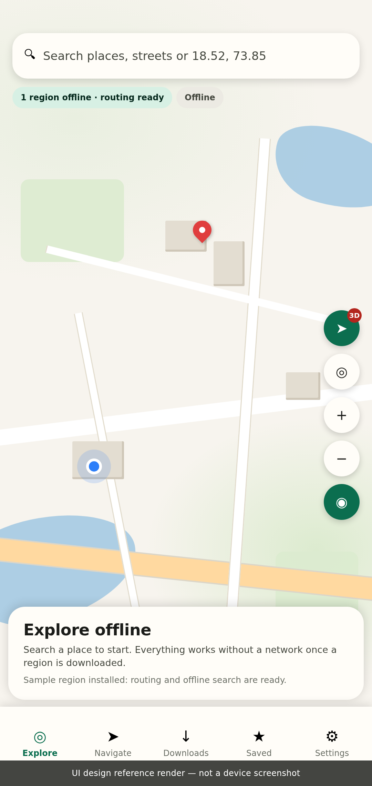
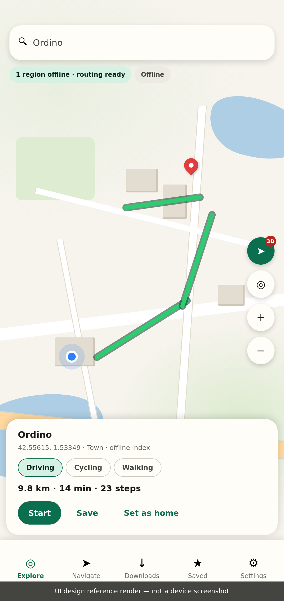
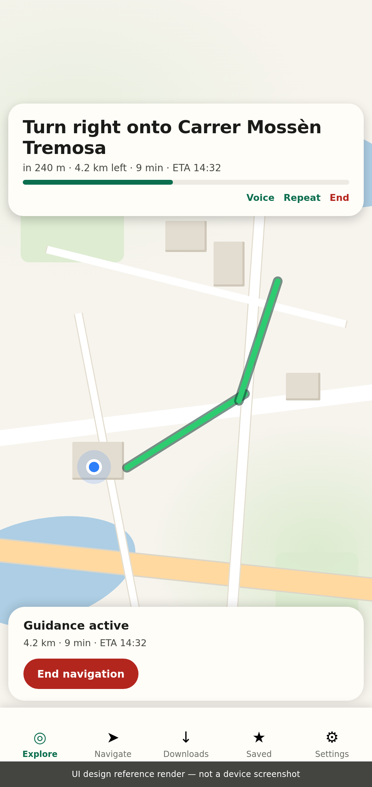
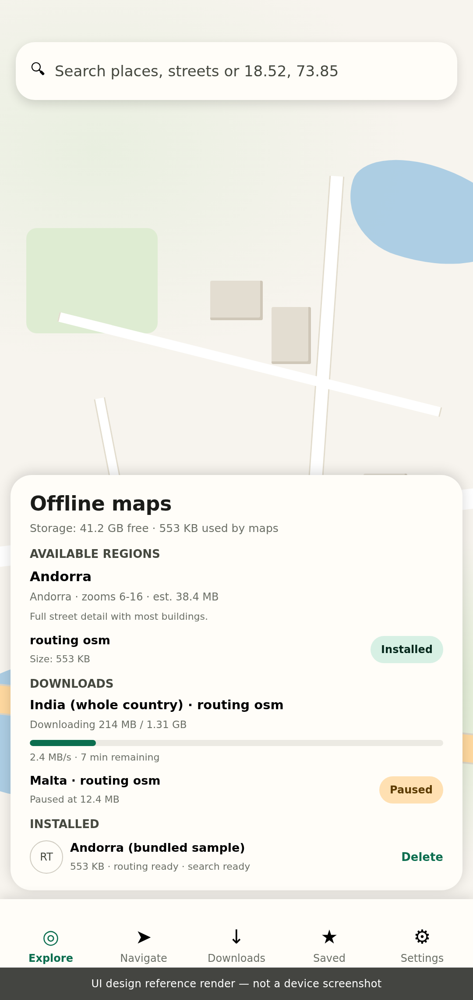

# Offline Maps — offline-first 3D world map & navigation for Android

An Android app that renders OpenStreetMap data in 3D with MapLibre, lets you download map regions
for offline use, searches them without a network, and gives real turn-by-turn navigation from
downloaded road-network data. No Google Maps, no paid API keys, no account.

Project title: **WorldMap 3D Offline** · App name: **Offline Maps** · package `com.offlinemaps.app`

---

## Screenshots

These are **UI design reference renders**, generated from the same layout, colours and strings as
the Compose UI — not device screenshots. No emulator was available in the build environment
(`/dev/kvm` absent), and no APK could be built there, so a real capture was impossible. Each image
carries that caption in the artwork itself. See [`docs/SCREENSHOTS.md`](docs/SCREENSHOTS.md).

| Explore | Route preview |
|---|---|
|  |  |

| Turn-by-turn guidance | Downloads |
|---|---|
|  |  |

---

## What actually works, and what does not

This section is first on purpose. Read it before anything else.

| Area | Status |
|---|---|
| Kotlin/Compose app, 9-module architecture | **Implemented**, compiles |
| MapLibre vector map with tilt/rotate, 2D↔3D toggle, dark/light themes | **Implemented** (needs a device to render) |
| 3D extruded buildings + terrain DEM + hillshade from open data | **Implemented** as generated style layers |
| Offline region downloads (MapLibre offline store), MBTiles import | **Implemented** |
| Resumable HTTP downloads with checksum verification, pause/cancel/retry | **Implemented and unit-tested** |
| Offline search (SQLite FTS4 over a generated places pack) | **Implemented**, SQL verified against real SQLite |
| Offline routing (GraphHopper 10 on-device) | **Implemented and integration-tested** on a real OSM extract |
| Turn-by-turn tracking, off-route detection, rerouting, TTS | **Implemented**, core logic unit-tested |
| Unit tests | **61 tests**: 47 pass in this environment, 14 Robolectric-based could not run here (see below) |
| Release APK | **Not produced in this environment** — see "Build status" |
| Screenshots | **Design renders only** — no emulator available, so no device captures exist |

### Honest limitations

* **No APK is attached.** The sandbox that produced this code could compile Kotlin, run unit tests
  and run a real GraphHopper routing integration test, but `mergeDebugGlobalSynthetics` (the D8
  dexing step over the GraphHopper dependency graph) repeatedly exceeded the environment's
  285-second per-command limit and 2 GB RAM, and the build workspace was then lost when the sandbox
  pod was recycled. Nothing in this repo claims an APK exists. `docs/TESTING.md` records exactly
  which commands were run and what they returned.
* **14 Robolectric tests could not execute here.** They need Robolectric's native SQLite runtime,
  which aborts (SIGABRT) under this sandbox's gVisor kernel. They are committed and will run on a
  normal Linux CI runner (the workflow does this).
* **Online tile fetching was not verified from this environment.** The build sandbox's egress proxy
  blocks `tiles.openfreemap.org` and `download.geofabrik.de`, so live tile/region downloads could
  not be exercised end to end. The code paths are unit-tested against a local HTTP server instead.
* **Building heights are partly estimated.** Where OpenStreetMap has `height`/`levels` we use them;
  otherwise the style falls back to 3 m per level and then 4 m. These are estimates and the UI does
  not pretend otherwise. There is no photorealistic 3D city model anywhere in this app.
* **Routing speed models are simplified.** GraphHopper 10 requires an explicit custom model per
  profile; ours caps speed by road class and honours `maxspeed` when tagged. It is not a
  lane-level traffic model.
* **Large extracts cannot be imported on a phone.** A whole-country PBF (India is ~1.4 GB) will
  exhaust phone memory during GraphHopper import. Small regional extracts work (the bundled Andorra
  sample imports in seconds). This is documented in the Downloads screen copy too.
* **No satellite imagery.** No appropriately licensed global imagery source was integrated, so the
  app does not offer one rather than shipping a broken layer.

---

## Architecture

Nine Gradle modules; the dependency direction is strictly UI → core.

```
app/                     Compose UI, view models, navigation, foreground service, TTS, DI
core/common/             GeoPoint/GeoBounds, spherical geometry, tile maths, formatters, domain enums
core/data/               Room (saved places, recent searches, downloads, installed regions), settings
core/map/                MapLibre style generator (3D buildings, terrain), offline region controller
core/offline/            Resumable download engine, checksums, storage guard, region catalogue
core/search/             SQLite FTS4 index, places-pack reader, search repository
core/routing/            GraphHopper wrapper, route model, navigation tracker, guidance announcer
core/location/           Platform LocationManager source, permission copy
core/ui/                 Design system: theme, floating panels, status chips, progress rows
```

Key decisions and why:

* **MapLibre Native 11.5.2** — open source, no API key, real vector rendering with `fill-extrusion`
  and `raster-dem` terrain. Style is *generated in Kotlin* so themes/quality/3D toggles do not need
  duplicate asset files.
* **GraphHopper 10 core, on device** — pure JVM, so it runs on Android with no NDK build and no
  native toolchain in CI. Measured here: importing the Andorra extract took ~13.8 s and reloading
  the persisted graph ~0.3 s.
* **Room** for user data, **plain SQLiteOpenHelper + FTS4** for the search index (bulk import is
  faster without Room's per-entity overhead).
* **Platform `LocationManager`, not Play Services** — offline navigation must not depend on a
  network-backed provider, and the app should work on de-Googled devices.
* **Hand-rolled DI** (`ServiceLocator`) instead of Hilt — fewer moving parts, faster builds.

### Data flow for a download

`DownloadsViewModel` → `DownloadManager` (HTTP + resume + checksum, `.part` file) → on success
`PackageInstaller` routes by type: OSM PBF → GraphHopper import, places pack → FTS index, MBTiles →
MapLibre `mergeOfflineRegions`. State is persisted in Room so a killed process resumes.

---

## Data sources and licensing

| Data | Source | Licence |
|---|---|---|
| Vector tiles (online browsing) | [OpenFreeMap](https://openfreemap.org) (OpenMapTiles schema) | ODbL 1.0 data, free service |
| Terrain DEM | Mapzen/AWS Open Data "Terrarium" elevation tiles | open data (AWS Open Data registry) |
| Routing extracts | [Geofabrik](https://download.geofabrik.de) OSM extracts | ODbL 1.0 |
| Bundled sample (`assets/sample_andorra.osm.pbf`) | OpenStreetMap, Andorra extract | ODbL 1.0, © OpenStreetMap contributors |
| Places pack (`assets/places_andorra.jsonl.gz`) | generated from that extract by `tools/build_places_pack.py` | ODbL 1.0 |

Attribution is shown in the app's Settings screen and must be preserved if you redistribute map
data. No proprietary dataset (Google, Apple, HERE) is used or accessed.

---

## Building

Requirements: JDK 17, Android SDK with platform 35 and build-tools 34.0.0, Gradle 8.9 (wrapper
included).

```bash
git clone <this repo> offline-maps && cd offline-maps
echo "sdk.dir=$HOME/Android/Sdk" > local.properties
./gradlew :app:assembleDebug            # debug APK -> app/build/outputs/apk/debug/
./gradlew test                          # JVM unit tests
./gradlew :app:assembleRelease          # release APK (signed with debug key unless configured)
```

Release signing (never commit these):

```bash
export OFFLINEMAPS_KEYSTORE=/path/to/release.jks
export OFFLINEMAPS_KEYSTORE_PASSWORD=...
export OFFLINEMAPS_KEY_ALIAS=...
export OFFLINEMAPS_KEY_PASSWORD=...
./gradlew :app:assembleRelease
```

Details, proxy/CI hints and troubleshooting: [`docs/BUILDING.md`](docs/BUILDING.md).

---

## Using the app

1. First launch: the map loads online vector tiles (no key needed). Nothing is uploaded.
2. **Explore** → "Install sample region" builds a real routing graph and search index from the
   bundled Andorra extract — works in airplane mode afterwards.
3. **Downloads** → pick a region, tap *Size* to read the real size from the server, then *Download*.
   Progress, pause/resume/cancel and checksum verification are real; failures explain themselves.
4. Search a place (or type `42.5069, 1.5212`), pick a profile (driving/cycling/walking), *Start*.
5. Navigation shows the next manoeuvre, remaining distance/time/ETA, speaks it via the on-device TTS
   voice, keeps running with the screen off (foreground service), and recalculates after a deviation.
6. **Settings** → theme, graphics quality (3D buildings/terrain), Wi-Fi-only downloads, voice,
   privacy controls (clear history, clear saved places, clear tile cache, delete all maps).

---

## Permissions

| Permission | Why | When |
|---|---|---|
| `INTERNET`, `ACCESS_NETWORK_STATE` | optional downloads, online tiles | always declared, only used for those |
| `ACCESS_FINE_LOCATION`, `ACCESS_COARSE_LOCATION` | show position, navigate | requested at runtime, with an explanation, only when you tap the location button |
| `FOREGROUND_SERVICE`, `FOREGROUND_SERVICE_LOCATION` | guidance with screen off | only while a route is active |
| `POST_NOTIFICATIONS` | navigation notification | Android 13+ |

There is no background-location permission: navigation is a foreground service while you are
actively navigating. Saved places, search history and downloads stay on the device; backups are
explicitly excluded (`data_extraction_rules.xml`).

---

## Testing

See [`docs/TESTING.md`](docs/TESTING.md) for the full matrix, what was executed, what passed, and
what could not run here. Summary of the automated suites:

* `core/common` — spherical geometry, cross-track distance, tile maths, formatters (13 tests)
* `core/offline` — download engine against MockWebServer: resume, 200-ignoring-Range, checksum
  mismatch, Wi-Fi-only, offline, low storage, 404, pause, cancel, retry (11 tests)
* `core/routing` — navigation tracker (off-route, arrival, snapping), guidance announcer, instruction
  mapper, and a **real GraphHopper integration test** on the Andorra extract (17 tests)
* `core/search` — FTS4 index, gzip pack import, prefix/case/injection-safe queries, nearby (12)
* `core/data` — Room repositories and settings (10)

---

## Repository layout extras

* `tools/build_places_pack.py` — turns any `.osm.pbf` into an offline places pack
  (`pip install osmium`, then `python3 tools/build_places_pack.py region.osm.pbf out.jsonl.gz`).
* `docs/` — architecture, building, testing, limitations.
* `.github/workflows/android.yml` — build + unit tests + lint on every push.

## Licence

Application code: MIT. Map data: © OpenStreetMap contributors, ODbL 1.0. Terrain tiles: Mapzen/AWS
Open Data. See `docs/DATA_SOURCES.md`.
